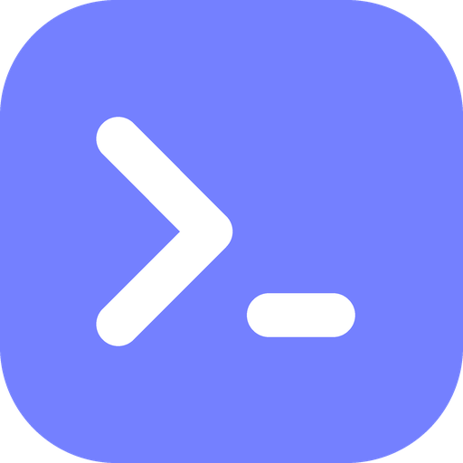

<p align="center"></p>

<h1 align="center">Atelier</h1>

<p align="center">Terminales organizadas por proyecto, con un canal privado para que tus sesiones de Claude Code coordinen solo dentro de su proyecto.<br>Windows 10/11 x64 · Linux (AppImage, .deb)</p>

---

## Español

Cada **proyecto** es una carpeta en la que trabajas. Los proyectos son pestañas arriba; a la izquierda están las
terminales del proyecto abierto, cada una con su nombre y su color. Una terminal nueva siempre arranca en la
carpeta del proyecto.

### Terminales

- **Hasta 3 paneles lado a lado.** Arrastra una terminal de la lista al borde de un panel para abrirla a ese lado, o
  al centro para mostrarla ahí. `Ctrl+Shift+5` divide.
- **Texto nítido y sin restos.** Renderizado por GPU con suavizado en escala de grises (o ClearType con el
  renderizador DOM), la fuente **Cascadia Code NF** incluida, color de 24 bits, imágenes (sixel), Unicode 11.
  Cada terminal se repinta por completo al volver a verse: no queda texto viejo encima del nuevo.
- **El prompt powerline de RDMan** en PowerShell, Git Bash, WSL, bash y zsh (usuario, equipo, carpeta, rama de git,
  código de error, duración). En cmd, la carpeta.
- **Pegar archivos y capturas.** `Ctrl+V` con archivos copiados en el Explorador pega sus rutas, citadas para tu shell
  (PowerShell, cmd, Git Bash o WSL). Una captura de pantalla se guarda como PNG y se pega su ruta (Claude puede
  leerla). También arrastrando archivos a la terminal, o con *Pegar como ruta* del clic derecho.
- Búsqueda (`Ctrl+Shift+F`), saltar entre comandos (`Ctrl+Shift+↑/↓`), copiar la salida del último comando, enlaces
  con `Ctrl+clic`, zoom (`Ctrl+rueda`), 12 paletas de colores.
- **Uso de recursos** en la barra de estado (CPU, RAM, disco, memoria de Atelier) y, en cada terminal, CPU y memoria
  de lo que está ejecutando.
- **Todo se restaura** al reabrir: proyectos, terminales, paneles y lo que mostraba cada terminal.
- Se actualiza solo desde GitHub Releases.

### Claude Code por proyecto

Claude Code, por sí solo, ve y escribe a **todas** las sesiones de tu equipo. Dentro de Atelier, `claude` queda
limitado a su proyecto:

- `atelier_peers`: las terminales del proyecto y si en cada una hay una sesión de Claude (libre, trabajando o esperando permiso).
- `atelier_send`: escribe a otra sesión del proyecto (o a todas). Llega como un mensaje en su prompt en cuanto esa
  sesión está libre; mientras tanto espera en cola.
- `atelier_inbox`: los mensajes recibidos.
- `atelier_read_output`: lee lo que muestra otra terminal del proyecto (un servidor de desarrollo, unas pruebas).

No se modifica nada global: Atelier pasa su configuración a cada sesión (`--settings`, `--mcp-config`), y un `claude`
abierto fuera de Atelier sigue igual. La lista lateral muestra el estado de cada sesión.

### Atajos

| | |
|---|---|
| `Ctrl+Shift+P` · `Ctrl+K` fuera de una terminal | Buscar proyectos, terminales y acciones |
| `Ctrl+Shift+T` / `Ctrl+Shift+W` | Nueva terminal / cerrarla |
| `Ctrl+Tab` · `Ctrl+Shift+Tab` | Siguiente / anterior terminal |
| `Ctrl+PgDn` · `Ctrl+PgUp` | Siguiente / anterior proyecto |
| `Ctrl+Shift+5` · `Ctrl+Alt+←/→` | Dividir · cambiar de panel |
| `Ctrl+Shift+O` | Agregar proyecto |
| `Ctrl+V` · `Ctrl+Shift+C` | Pegar · copiar (`Ctrl+C` copia si hay selección) |
| `Ctrl+,` | Configuración |

`atelier <carpeta>` abre esa carpeta como proyecto en la ventana que ya esté abierta.

---

## English

Projects (folders) are tabs at the top; the left sidebar lists the open project's terminals, each with a name and a
color, and every new terminal starts in the project's folder. Up to three terminals side by side; GPU-rendered text
that is fully repainted whenever a terminal is shown again (no stale text); RDMan's powerline prompt in PowerShell,
Git Bash, WSL, bash and zsh; `Ctrl+V` pastes copied files as paths quoted for your shell and screenshots as the path
of a saved PNG; resource usage in the status bar and per terminal; full restore on restart; auto-updates.

Claude Code sessions started in an Atelier terminal get `atelier_peers`, `atelier_send`, `atelier_inbox` and
`atelier_read_output`, which only reach the sessions of the same project; Claude Code's machine-wide messaging tools
are turned off inside Atelier. Nothing global is changed: the configuration is passed per session.

## Build

```sh
npm ci
npm run dev          # run from source
npm test             # unit tests
npm run build && npm run e2e
npm run dist         # installer (Windows) / AppImage + deb (Linux) in release/
```

Releases: push a tag `vX.Y.Z`; the Release workflow builds and publishes them.

The installer is not code-signed; SmartScreen may warn the first time.

License: MIT. Cascadia Code is © Microsoft, SIL Open Font License.
